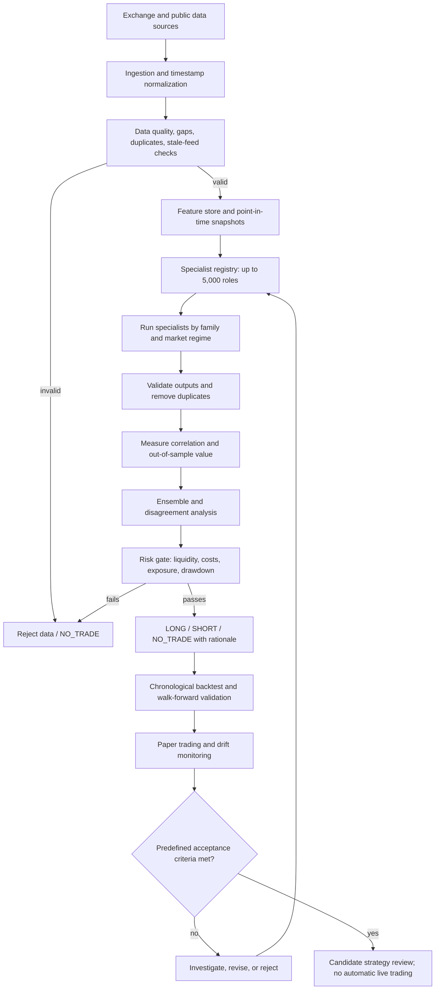

# Research plan: 5,000-specialist crypto strategy

This document is the execution plan for a research system composed of **up to 5,000 specialist analyses**. The number is a target for distinct, testable analytical roles—not a claim that 5,000 independent profitable experts already exist. Specialists must be grouped, deduplicated, tested, and selected based on out-of-sample value.

## Workflow diagram

## Build stages

### Stage 1 — Reproducible foundation
- Freeze data schemas, UTC timestamps, symbol/venue conventions, and point-in-time data rules.
- Create a dataset manifest and record source, retrieval time, and missing-data flags.
- Add unit tests, deterministic runs, logging, configuration, and CI.
- Keep credentials out of source control.

### Stage 2 — Baselines before scale
- Implement simple trend-following, momentum, and mean-reversion baselines.
- Establish benchmarks and transaction-cost assumptions before adding many specialists.
- Test chronological splits and a final untouched holdout to reduce leakage and overfitting.

### Stage 3 — Specialist taxonomy and registry
Organize the target roles into families, for example:
1. Market data quality and microstructure
2. Price action, trend, and technical indicators
3. Volume, order flow, liquidity, and execution costs
4. Derivatives, funding, open interest, and liquidations
5. On-chain, tokenomics, and protocol fundamentals
6. News, events, and sentiment
7. Macro and cross-asset context
8. Statistical models and regime detection
9. Portfolio construction and risk controls
10. Validation, calibration, drift, and ensemble governance

Each specialist must have a unique hypothesis, documented inputs, version, timestamp cutoff, test suite, and explicit abstention behavior. Similar specialists must not be counted as independent votes.

### Stage 4 — Evaluation and selection
- Evaluate each specialist independently and incrementally; do not launch all 5,000 at once.
- Measure incremental out-of-sample contribution after fees, spread, slippage, funding, and latency.
- Account for multiple testing, correlated signals, and regime changes.
- Keep specialists only if they improve robust performance or risk characteristics on unseen data.

### Stage 5 — Ensemble and risk gate
- Weight evidence using validation data, reliability, regime, freshness, and dependence between specialists.
- Output LONG, SHORT, or NO_TRADE; disagreement or poor data quality should increase abstention.
- Enforce portfolio limits independently of signal confidence.
- Never treat a model score as a guaranteed probability unless calibration has been demonstrated.

### Stage 6 — Backtest, paper trade, review
- Run walk-forward backtests and a final untouched holdout.
- Report net expectancy, drawdown, Sharpe/Sortino with caveats, turnover, exposure, calibration, and benchmark comparisons.
- Paper-trade with live market data, record hypothetical fills and costs, and monitor model drift.
- Live execution remains disabled unless explicit acceptance criteria, operational safeguards, and user approval are in place.

## Initial acceptance gates
Thresholds must be chosen before viewing final holdout results and tailored to the strategy. At minimum:
- No known look-ahead leakage or unexplained data gaps.
- Positive net performance under conservative costs across multiple walk-forward windows.
- Drawdown and exposure within a pre-agreed risk budget.
- Results robust to modest parameter changes and not dependent on one asset or brief period.
- Paper-trading behavior consistent with backtest assumptions.
- Reproducible reports and review of failure cases.

## Deliverables
1. Tested data ingestion and validation.
2. Baseline strategies and reproducible backtester.
3. Specialist interface and registry.
4. Evaluation report showing which specialists add value and which are rejected.
5. Ensemble, risk gate, and paper-trading report.
6. A strategy recommendation only if evidence supports it; otherwise, a documented NO-GO.

**Important:** A large number of specialists does not guarantee better predictions or profit. The goal is the strongest strategy supported by reproducible out-of-sample evidence, including the possibility that no strategy passes the acceptance gates.
