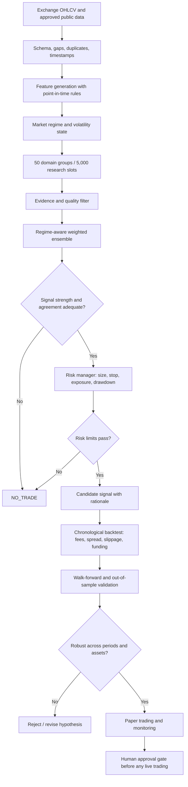

# Research blueprint: 5,000-slot crypto strategy ensemble

## What "5,000 specialists" means in software
The system will model 5,000 configurable research slots across 50 domains (100 slots per domain). These are not real people and are not 5,000 independent, proven models. Initially, most slots are inactive placeholders. A slot only becomes eligible to vote after it has a documented hypothesis, deterministic implementation, unit tests, and out-of-sample evidence.

## Flow

## Specialist domains (50)
1. Trend following
2. Mean reversion
3. Breakouts
4. Price action
5. Candlestick patterns
6. Support/resistance
7. Market structure
8. Momentum
9. Volume profile
10. Volume flow
11. Volatility
12. Market regime
13. Multi-timeframe analysis
14. Moving averages
15. RSI/stochastics
16. MACD/momentum
17. Bollinger bands
18. VWAP
19. Order book
20. Liquidity
21. Funding rates
22. Open interest
23. Basis/spread
24. Liquidations
25. Perpetual futures
26. Spot flows
27. On-chain activity
28. Exchange flows
29. Stablecoin flows
30. Tokenomics
31. Protocol fundamentals
32. Macro economics
33. Cross-asset correlations
34. Relative strength
35. Sentiment
36. News/events
37. Social metrics
38. Calendar effects
39. Seasonality
40. Statistical arbitrage
41. Cross-exchange arbitrage
42. Pairs trading
43. Market-making research
44. Execution costs
45. Portfolio allocation
46. Risk management
47. Drawdown control
48. Regime validation
49. Walk-forward validation
50. Data quality

## Delivery stages
- **Stage 1 — Research scaffold:** data contracts, signal interface, risk controls, tests, transparent baseline.
- **Stage 2 — Data:** historical OHLCV loader, data validation, caching, missing-candle reports, UTC timestamps.
- **Stage 3 — Specialists:** implement a few interpretable specialists per domain; inactive slots never vote.
- **Stage 4 — Ensemble:** weight only by predeclared out-of-sample evidence; cap correlated votes; allow abstention.
- **Stage 5 — Validation:** chronological split, walk-forward evaluation, fees/spread/slippage/funding, multiple assets and regimes, compare with buy-and-hold and simple baselines.
- **Stage 6 — Paper trading:** log every input, prediction, rationale, latency, and hypothetical fill; monitor drift.
- **Stage 7 — Optional deployment review:** only after sustained out-of-sample and paper-trading results, explicit human approval, kill switch, limits, and secret management.

## Required metrics
Net return after modeled costs, maximum drawdown, Sharpe/Sortino with caveats, turnover, win/loss distribution, exposure, tail loss, trade count, performance by asset and regime, and comparison to simple baselines. Avoid selecting a strategy on one metric or one lucky period.

## Non-negotiable safeguards
- No claim of guaranteed profit.
- No live order placement in the research phase.
- No look-ahead leakage; signal at bar t can only use information available by t.
- Reserve an untouched final test period.
- Include fees and conservative slippage assumptions.
- Reject unstable strategies and permit NO_TRADE.
- Never commit exchange API secrets.
